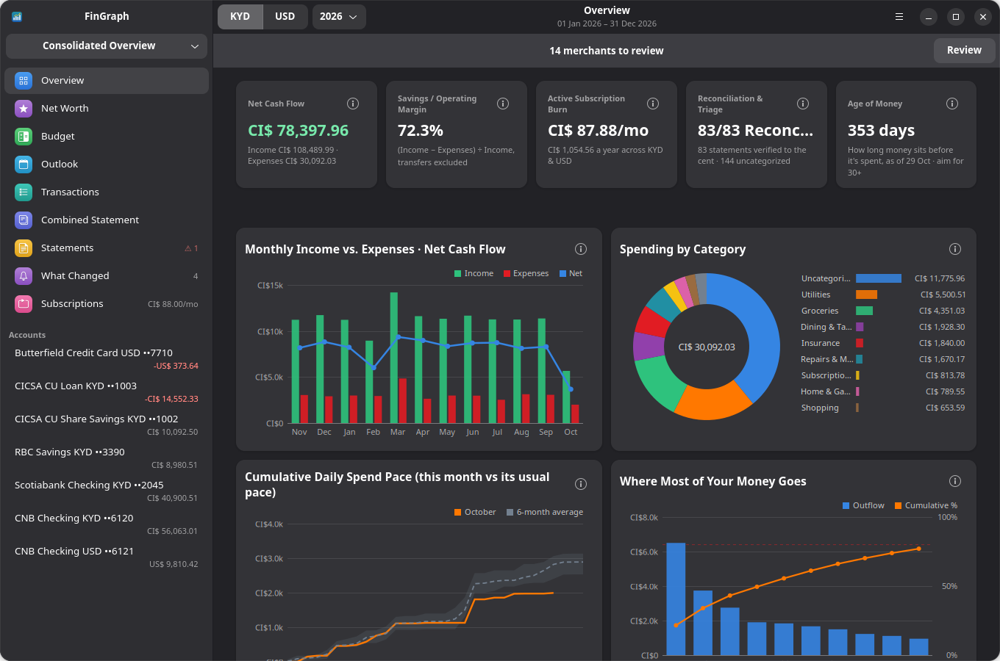
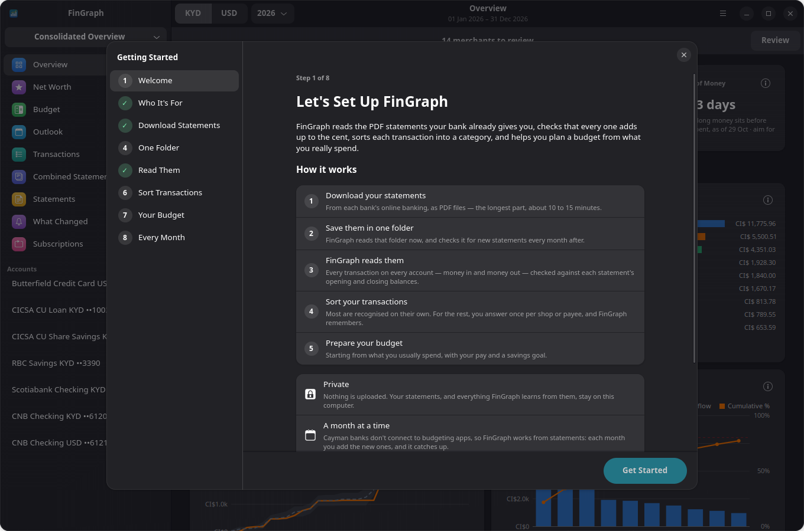
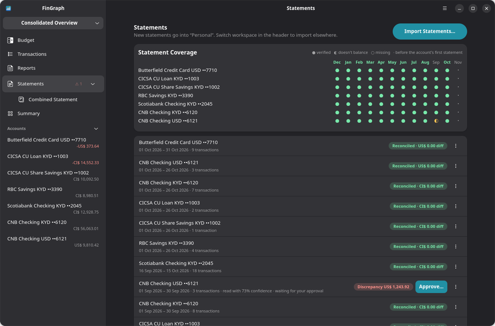
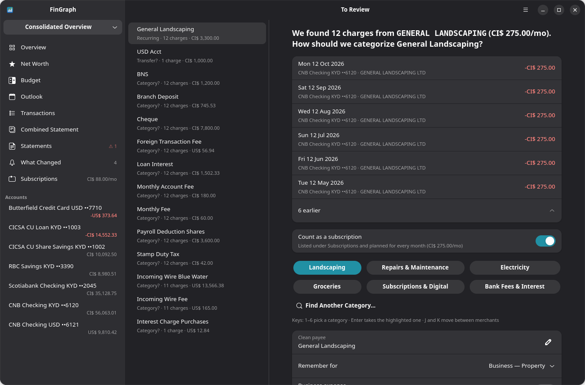
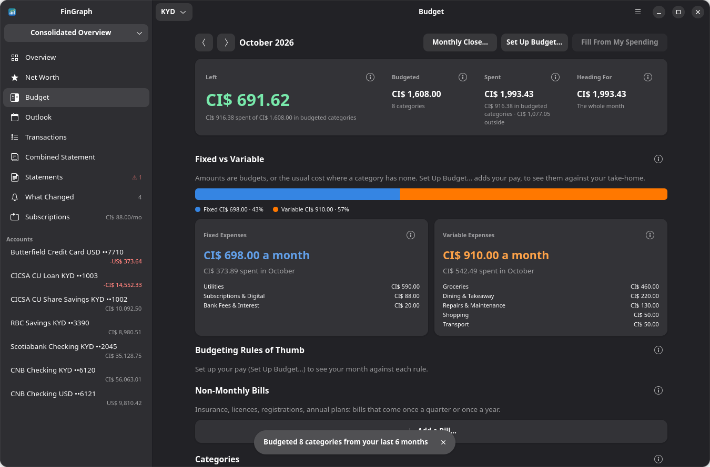
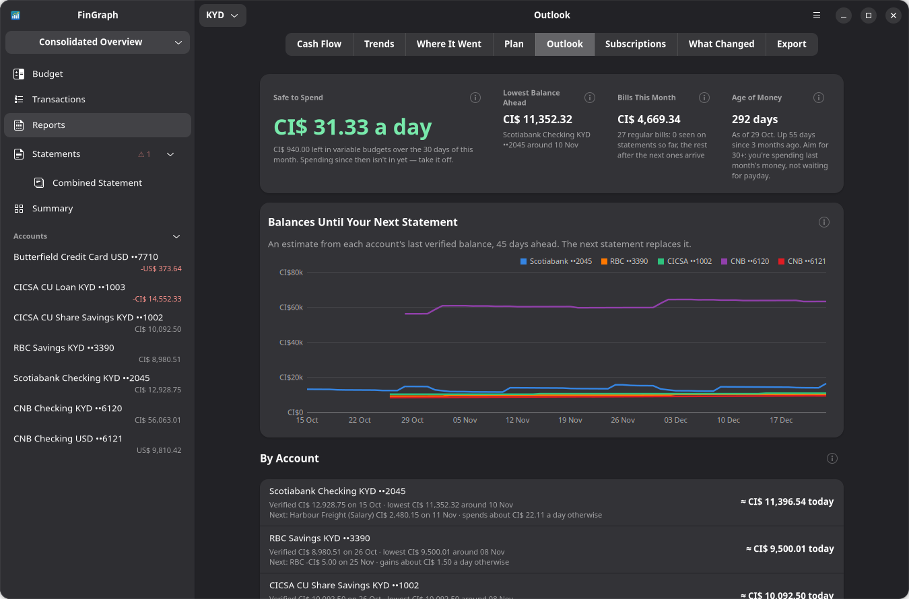
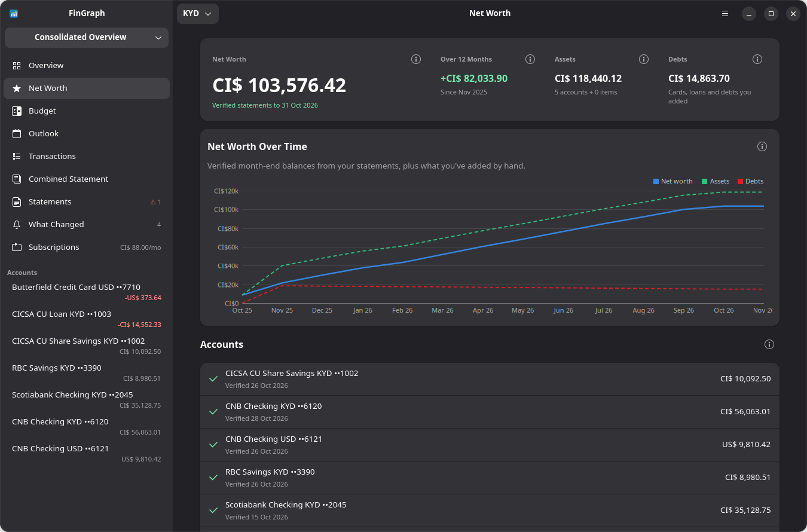
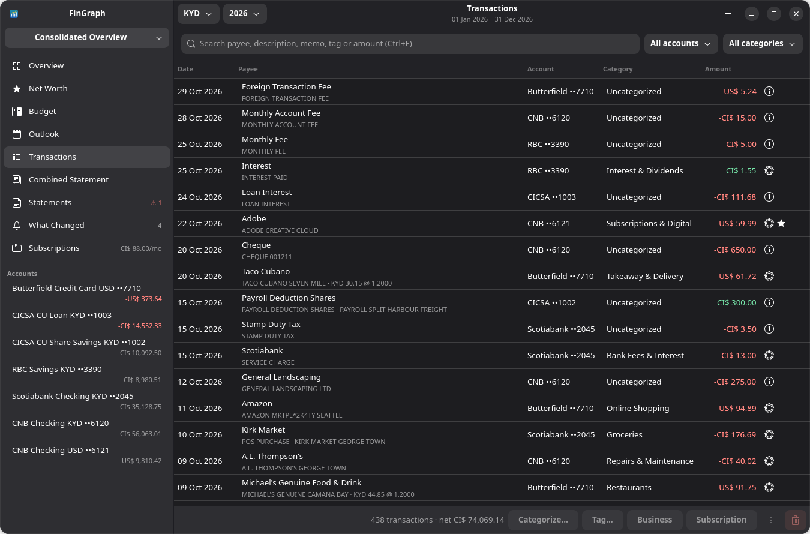
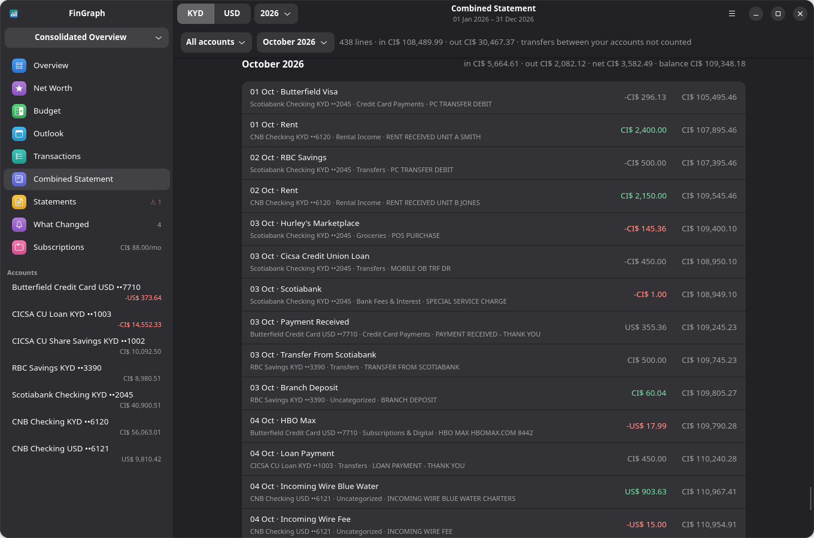

# FinGraph

A local-first ledger and budget for Cayman bank statements, in Rust with GTK 4 and libadwaita.

Cayman banks don't offer live feeds to budgeting apps, so FinGraph works from the PDF statements you
download once a month. A 5-pass scanner reads each statement and proves it against its own
balances. Your rules, a directory of Cayman businesses and Smart Triage then sort the
transactions. On top of that sit a budget, a forecast for the weeks between statements, and your
net worth, in KYD or USD, across personal and business workspaces.

Nothing leaves the computer. Everything lives in `~/.local/share/fingraph/`: the ledger, kept copies
of your statements and backups. The full product and system reference is
[`docs/PRD.md`](docs/PRD.md).



*Every screenshot here uses the built-in demo data (simulated statements for made-up accounts),
never a real ledger.*

## Install

```sh
sudo apt install poppler-utils tesseract-ocr libgtk-4-dev libadwaita-1-dev
cargo deb -p fingraph
sudo apt install ./target/debian/fingraph_0.2.10-1_amd64.deb
```

Or run it from source with `cargo run -p fingraph --release`.

- `poppler-utils` is required: `pdftotext` gives the scanner every word with its position.
- `tesseract-ocr` is recommended. It reads statements that are only pictures, such as redacted or
  scanned ones.

Same-version `.deb`s need `sudo apt install --reinstall …`, so every release gets a new version
number.

## Getting started

The first time it opens, **Getting Started** walks you through setup. After a welcome page, its steps are:

1. Choose your workspaces.
2. Download your statements from each bank's online banking.
3. Put them in one folder, which FinGraph watches.
4. Let FinGraph read them.
5. Sort what it didn't recognise.
6. Set up a budget, including your big yearly bills.
7. Learn the monthly routine.

The guide stays in the main menu and remembers where you stopped. To explore without your own
data, the empty Overview and the guide both offer **Load Demo Data**: a simulated year for a
personal and a property-business workspace, across all five banks, in KYD and USD.



### Once a month

1. Save last month's statements into the watched folder; FinGraph reads them when it opens. Or use
   **Import Statements…** in the main menu, or drop them on the **Statements** page.
2. Answer anything it asks (see [Importing statements](#importing-statements)), and anything waiting
   in **To Review**.
3. Run **Monthly Close** on the Budget page.
4. Between statements, **Outlook** shows where balances are heading and what's safe to spend.

## Finding your way around

**Sidebar**, in order:

| Page | Ctrl+ | What it shows |
|---|---|---|
| Overview | 1 | Ten headline cards in two rows (net cash flow for a year, a month and a fortnight, each measured as a 12-month average, the date range or the actual period; left to spend this month; savings rate; next big bill; cash runway; Age of Money; subscriptions; reconciliation), **Big Bills Coming Up** and **Big Bills Over the Next 12 Months**, and six charts; a **Review** banner while merchants wait for an answer |
| Net Worth | 2 | What you own and owe over time, goals, and debt payoff |
| Budget | 3 | This month against your plan, rollovers, non-monthly bills, watchlists, and where the money went |
| Outlook | 4 | Balances until the next statement, safe to spend, the month's bills, and Age of Money |
| Transactions | 5 | Every transaction: search, filter, edit, split, attach receipts |
| Combined Statement | 6 | Chosen accounts month by month with one running balance |
| Statements | 7 | Every statement read, its reconciliation, coverage by month, and anything waiting for approval |
| What Changed | 8 | Price rises, bill spikes, possible double charges, fees, and category drift |
| Subscriptions | 9 | Recurring charges and what they really cost a year |

Below the pages, **Accounts** lists each account with its last balance a statement confirmed (red
when it's money owed). Click one to open that account's overview.

The **main menu (☰)** has Import Statements…, Reports & Export, Rules & Categories, Business
Directory, Bank Profiles, Preferences (Ctrl+,), Getting Started and About.

**ⓘ buttons.** Every card on Overview, Budget, Outlook and Net Worth has an ⓘ next to its title.
Hover over it to see how to read the card, or click to keep the explanation open.

The header shows only the controls the page uses: the date range, and **KYD | USD**. Ctrl+F
searches transactions and Ctrl+O imports.

## What it does

### Reads statements and proves them

- **Banks:** Butterfield, Scotiabank, Cayman National (CNB), RBC and the CICSA Credit Union.
- **Five passes:**
  1. Find the bank.
  2. Find the columns.
  3. Read the rows.
  4. Check every running balance.
  5. Check that opening balance + transactions = closing balance.

  Statements that are only pictures are read with OCR.
- **Declared layouts.** Each bank profile writes down its layout: whether the amount comes before
  or after the description, the bank's own summary labels, and which account types have been
  checked against a real statement. A statement that breaks the layout gets a note naming the
  rule. This catches statements that add up but are still wrong.
- **Unreadable lines.** Anything the scanner can't read is shown in the Scan Pass Report, with a
  one-click **Convert** to turn a skipped line into a transaction.

### Importing statements

- **New accounts** are asked about ("Is this your account?"), never added silently. Accounts are
  matched on bank + last four digits + currency.
- **Repeat periods.** A second file for an account and period you already have asks before
  replacing it, so the same statement can't count twice.
- **Statements held for review.** These stay on the Statements page as **Waiting for review**, and
  their transactions count nowhere until you **Approve** them:
  - statements that don't reconcile
  - statements read by OCR
  - the first statement of each account type from a bank
  - statements that break the bank's layout
- **Re-reading.** **Rescan All** (Preferences, or Rules & Categories) re-reads every kept
  statement. Your edits are kept, and it backs up first.



### Sorts transactions

The steps are tried in this order:

1. Your rules. A rule can be limited to an amount (*only when CI$ 125.00*) or match a reference
   number.
2. Transfers between your accounts and credit card payments.
3. A directory of 582 Cayman businesses and online services.
4. Keyword guesses (MARKET → groceries, DIGITAL → subscriptions).
5. Whatever's left goes to **To Review**. There's one card per merchant with every charge listed;
   answer it once and the answer is applied to past and future statements. Suggestions come from
   how you filed similar charges.



### Keeps money apart

- **Workspaces:** Personal, Business, Rental and so on, or a consolidated view across any set.
- **Business expenses:** a business-expense flag on transactions.
- **Splits:** for example, the rental's share of one receipt.
- **Business owes you:** cards track personal money spent on the business until it's paid back.
- **Projects (tags):** total landed cost, including freight and customs duty.

### Budget

- **Setting it up:**
  - **Monthly amounts** per category, filled from what you usually spend (the median of the last
    six months).
  - **Setup wizard (5 steps):** pay cycle, gross pay and deductions; other income and loan
    payments; **big yearly bills**; spending; a savings goal. It does the arithmetic, including how
    much flexible spending must shrink to reach the goal.
  - **Big yearly bills:** the setup asks about the costs a normal month never shows. These include car and
    home insurance, HOA or strata fees, vehicle licence, school terms, memberships, travel, and
    Christmas. Bills seen in your statements are filled in. Each one gets a monthly set-aside, which
    comes out of what you can save.
- **During the month:**
  - **Alerts** when a category is over budget, or 85% used early in the month.
  - **Fixed vs variable expenses**, and a **12-month savings projection**, both on budget and on
    trend.
- **Changing it:**
  - **Rollovers:** leftovers carry over to the next month.
  - **Money moves** cover an overspend.
  - **Set-asides** for yearly and quarterly bills (Budget → Non-Monthly Bills).
  - **Watchlists** cap a merchant (Amazon CI$ 150).



- **Monthly Close** takes you through the month once its statements are in. It checks they're all
  there, sorts what's new, settles the budget, ticks off the regular bills (paid, missed, or not on
  a statement yet), updates goals, and ends with a summary.

### Outlook and Net Worth

- **Outlook** covers the weeks before the next statement arrives:
  - each bank account's estimated balance until then
  - the lowest point ahead
  - safe to spend per day
  - the month's bills
  - **Age of Money:** how long money sits before it's spent
- **Net Worth:**
  - statement balances plus assets and debts you value by hand, over time
  - **goals** (save up, or pay a card down) with on-track status
  - **debt payoff:** highest rate first vs smallest balance first, with rates read from your
    interest charges





### Transactions and the Combined Statement





### Reports and receipts

- **Receipts:** drop a PDF or photo on a transaction.
- **Exports:** CSV, QIF, OFX 1.0.2, QuickBooks QBO per account, a P&L, and a P&L with every receipt
  for your accountant.

Money is `rust_decimal::Decimal` end to end, stored as the exact string plus integer cents next to
its currency. The KYD/USD peg (1 KYD = 1.20 USD) is the default rate; a rate printed on a statement
wins for that transaction.

## How accurate is each bank?

| Bank | Checked against | Status |
|---|---|---|
| Scotiabank | 34 real statements: chequing, Amex, Mastercard; KYD and USD | Reconciles to the cent, layout verified |
| Cayman National | 1 real (redacted, third-party) savings statement, read by OCR | 95 of 95 transactions, reconciles |
| Butterfield, RBC, CICSA | Simulated layouts only | Untested on a real statement |

For the three untested banks, the first statement of each account type is held for review. To
bring one up to accuracy:

1. Use **Bank Profiles → Test PDF**. To pass, the statement must be recognised as the right bank,
   reconcile to the cent, and have no layout notes.
2. Use **Save Layout Sample…**. It keeps every word's position, the dates, amounts and headings,
   and turns names, merchants and account numbers into `xxx` and `000`. Samples go in
   `crates/fingraph-core/tests/fixtures/private/`, which git ignores, and become tests.
3. Approve the first import after comparing it with the PDF.

The details are in the PRD, §6.3.

## Code layout

| Path | What |
|---|---|
| `crates/fingraph-core` | No GUI. Scanner (`parser/`: profiles, multipass, dates, reconcile, OCR), ledger and import rules (`db.rs`), rules and triage (`rules.rs`), learning (`learn.rs`), directory (`merchants.rs`, `data/merchants.tsv`), splits, reimbursements, attachments and coverage (`workflows.rs`), `insights.rs`, `budget.rs`, `outlook.rs`, `wealth.rs`, exports, preferences, demo statements |
| `crates/fingraph` | The app, one file per page or dialog: `dashboard`, `wealth`, `budget`, `close`, `outlook`, `transactions`, `statement`, `statements`, `changes`, `rules`, `review`, `account`, `export`, `directory`, `profiles`, `preferences`, `guide`, `wizard`, `split`, `owed`, `txedit`. Cairo charts are in `charts.rs`; the shell, sidebar, menu and shared helpers are in `main.rs` |
| `packaging/` | Desktop entry (PDF "Open With") and icon |
| `docs/PRD.md` | Product and system reference, decisions log, known limits |

## Adding businesses

Add one line per business to `crates/fingraph-core/data/merchants.tsv`:

```
KEYWORDS<TAB>Name<TAB>Category[<TAB>fallback]
HOME GAS|HOMEGAS	Home Gas	Gas
```

- **Matching:** keywords match whole words. Punctuation and apostrophes are ignored, and a trailing
  S is allowed. The earliest match in the statement text wins, then the longest.
- **Generic words:** never add a generic word on its own.
- **`fallback`:** marks a payment platform (Google, Apple) that gives way to the service it billed.

Rebuild after editing. To browse the directory in the app, use main menu → **Business Directory**.
It shows search, how often each business appears in your statements, keyword guesses, and
**Override…** to make your own rule. For a one-off, answering in To Review or adding a rule is
quicker and always wins.

## Terminal tools

```sh
cargo run -p fingraph-core --example scan -- statement.pdf          # scanner report for one PDF
cargo run -p fingraph-core --example ledger -- reapply              # re-run rules, card payments, directory
cargo run -p fingraph-core --example ledger -- rescan               # re-read every kept statement
cargo run -p fingraph-core --example ledger -- cards                # recognise credit card payments
cargo run -p fingraph-core --example ledger -- reset                # forget learned rules and categories
```

Close the app first, and back up from Preferences → Data. Run from the app instead, Rescan and Reset
back up on their own.

## Tests

```sh
cargo test --workspace                                # 70 tests: banks and layouts, OCR, import rules, ledger, rules, directory, budget, insights, exports
cargo test -p fingraph-core -- --ignored real         # also scans your own statements in ~/.local/share/fingraph/documents
cargo test -p fingraph-core -- --ignored private      # layout samples in tests/fixtures/private/
cargo clippy --workspace --all-targets
```

Debug builds can screenshot any page without a person at the keyboard. For example:

```sh
FINGRAPH_DB=/tmp/x.db FINGRAPH_DEMO=1 FINGRAPH_VIEW=budget FINGRAPH_SHOT=out.png cargo run -p fingraph
```

That uses a scratch ledger. Never point `FINGRAPH_DB` at your real one.

The README screenshots in `docs/screenshots/` were taken this way from a fresh demo ledger, with
**Fill From My Spending** pressed on Budget (`FINGRAPH_CLICK="Fill From My Spending"`) so the budget
has something in it.
